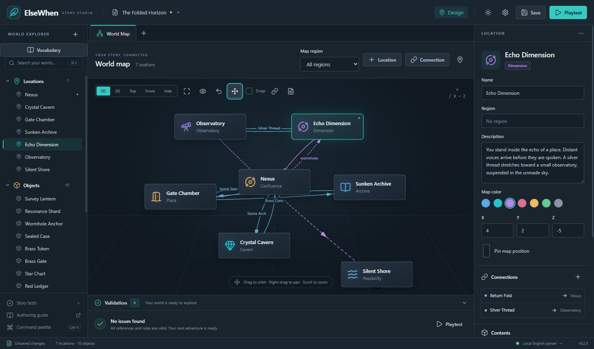

# ElseWhen

ElseWhen is a Windows-first desktop studio for traditional parser-based interactive fiction. Create locations, objects, characters, vocabulary and visual rules, then play your story with a transcript, inventory and interactive 2D/3D map. Both dark and light themes are included.

Version 0.2 uses a deterministic local English parser. Authoring, interpretation, tests, export, save and restore work offline. No account, model or API key is involved.



## Run

Use Node.js 22.12 or newer and pnpm 11.25.0.

```sh
pnpm install --frozen-lockfile
pnpm dev
```

Choose **Create a world** or **Explore the sample**. Open the additional **The Courtyard** project in examples/local-adventure/project.elsewhen.json for a small locked-drawer puzzle and a custom bell interaction.

**Vocabulary** browses standard actions, maps synonyms to specific command forms and previews interpretation. **Custom Actions** uses sentence shapes and role chips. **Rules & events** supplies requirements, consequences, responses and scheduled behavior. **Story tests** runs isolated command sequences with visual assertions.

In playtest, **Open Game Player** moves the existing session to a separate native window. Return it to the designer or close that window to reattach it. The session, pending question, history and unfinished input remain available.

## Commands

Try: look; take key; unlock drawer with key; put photograph in case; put book on desk; ask caretaker about photograph; say "hello" to caretaker; north.

Use THEN or semicolons for sequences. Lists, ALL, exclusions and quantities are supported. Ambiguous requests ask a question. HELP, COMMANDS, SAVE, RESTORE, UNDO, REDO, RESTART, AGAIN and CANCEL are system commands.

## Project and game files

Save .elsewhen.json source projects for authoring. Export .elsegame packages for offline players; they open with the ElseWhen application. Progress files use .elsesave. Version-one projects migrate on a copy and require Save As. Review migration notices in Vocabulary. Old portable saves require the old application; version-two saves require the exact compiled game revision.

## Development

| Command                | Purpose                                                   |
| ---------------------- | --------------------------------------------------------- |
| pnpm dev               | Run the desktop studio                                    |
| pnpm typecheck         | Check application and shared types                        |
| pnpm lint              | Run ESLint                                                |
| pnpm test              | Run local parser, engine, migration and persistence tests |
| pnpm test:e2e          | Build and test real Electron workflows                    |
| pnpm generate:example  | Regenerate both sample projects                           |
| pnpm validate:examples | Validate and play both sample scenarios                   |
| pnpm stress            | Exercise the large-world fixture                          |
| pnpm build             | Build the host, preload and renderer                      |
| pnpm package:win       | Create Windows installer and portable builds              |

## Documentation

- [Authoring guide](docs/authoring-guide.md)
- [Command reference](docs/command-reference.md)
- [Engine semantics](docs/engine-semantics.md)
- [Architecture](docs/architecture.md)
- [Formats and migration](docs/project-format.md)
- [Sample walkthrough](docs/sample-walkthrough.md)
- [Verification and compatibility notes](docs/implementation-status.md)

Windows artifacts are unsigned development builds. macOS and Linux packaging configurations require validation on their respective platforms.
