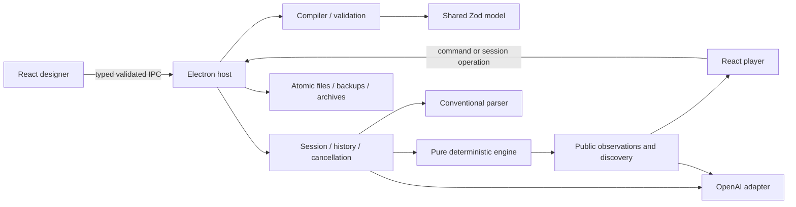

# Architecture

ElseWhen is an Electron desktop application with a React renderer and a sandboxed, context-isolated preload. The project model is shared, but runtime authority stays in the main process.

## Source boundaries

| Path                                  | Ownership                                                                    |
| ------------------------------------- | ---------------------------------------------------------------------------- |
| `packages/domain/src/index.ts`        | Authored schemas, stable IDs, runtime types, built-in action catalog         |
| `packages/engine/src/index.ts`        | Scope, conditions, transactions, rules, events, observations, projection     |
| `packages/compiler/src/validation.ts` | Browser-safe project checks and template resolution                          |
| `packages/compiler/src/index.ts`      | Deterministic compilation and SHA-256 runtime identity                       |
| `packages/parser/src/index.ts`        | Conventional and fixture parsers, strict response validation, public context |
| `packages/parser/src/openai.ts`       | Responses API adapter and versioned prompt                                   |
| `packages/persistence/src/index.ts`   | Source saves, locks, recovery, ZIP import/export, portable saves             |
| `apps/desktop/src/main/session.ts`    | Host-owned runtime snapshot, history, queues, cancellation, debug mutations  |
| `apps/desktop/src/main/index.ts`      | Native dialogs, credentials, IPC, menu, settings, session lifecycle          |
| `apps/desktop/src/preload/index.ts`   | Allowlisted request bridge; no filesystem or credentials exposed             |
| `apps/desktop/src/renderer/`          | Designer forms, maps, player, visual rules, scenarios, themes                |

The engine imports domain code only. It has no React, Electron, DOM, OpenAI, filesystem, network, or wall-clock dependency. Simulation randomness is a stored 32-bit LCG state.

## Definitions versus play state

Source projects describe initial placement, capabilities, rules, prose, and map layout. Compilation validates references, resolves reusable object defaults, strips private author prose/tests, and produces a runtime content hash. A session receives that compiled snapshot. Runtime manipulation changes only `GameState`.

Undo/redo restores state, transcript boundaries, and referents together. Host revisions and cancellation epochs never move backward. The renderer receives `PlayerView`, plus privileged state/trace information only for designer playtests.

Map coordinates are presentation data. There is no proximity-based navigation. Player maps contain only known locations and exits. Unknown destinations use anonymous IDs derived from known exit IDs, not secret location IDs.

## UI and styling

The renderer uses reusable controls and CSS tokens in `theme.css`. Dark and light themes cover forms, transcripts, maps, rule blocks, and diagnostics. No downloaded images, web fonts, remote content, or application server is required. A small original SVG feather supplies branding and the rasterized desktop icon.

Forms, reparenting, duplication, deletion, numeric map moves, and automatic layout use a single Zustand editor history. Consecutive edits to the same field within 700 ms coalesce. IDs survive renaming. Deletion deliberately preserves dangling references as visible draft errors after an explicit reference report.

Three.js / React Three Fiber handles the 3D map; an SVG graph supplies the 2D fallback. Orthographic views and a location-list alternative share the same data. Labels use an isolated HTML portal so switching map views does not let React and Three's cleanup remove one another's DOM nodes.

## Desktop security

Renderer Node integration is disabled; context isolation, renderer sandboxing, web security, CSP, navigation denial, window-open denial, and permission denial are enabled. IPC checks sender identity and validates individual payloads. Imported text is rendered as text with a small emphasis renderer; there is no HTML evaluation, JavaScript rule language, or shell capability.

Source and save files are bounded to 25 MB. Game archives must contain exactly `manifest.json` and `game.json`; central directory names, duplicate entries, symbolic links, format versions, expanded sizes, and content hashes are checked. Runtime packages are inspectable local data, not encrypted secrets.

## Compatibility choices

Electron 44.7.2, electron-vite 6.0.0, React 19.3.1, Three 0.186.1, Zod 4.6.7, and OpenAI SDK 7.34.0 were installed together. TypeScript 6.0.3 is used for lint compatibility. Windows workflow tests use Playwright's actual Electron integration. macOS and Linux packaging configurations are present but require their own platform runs.

The installed runtime needed an `ALL APPLICATION PACKAGES` read/execute ACL on this development host because the workspace inherited an AppContainer-specific ACL. The runtime directory alone was adjusted; Electron sandboxing stayed enabled. A normal checkout outside that restricted workspace may not need this host-specific repair.
